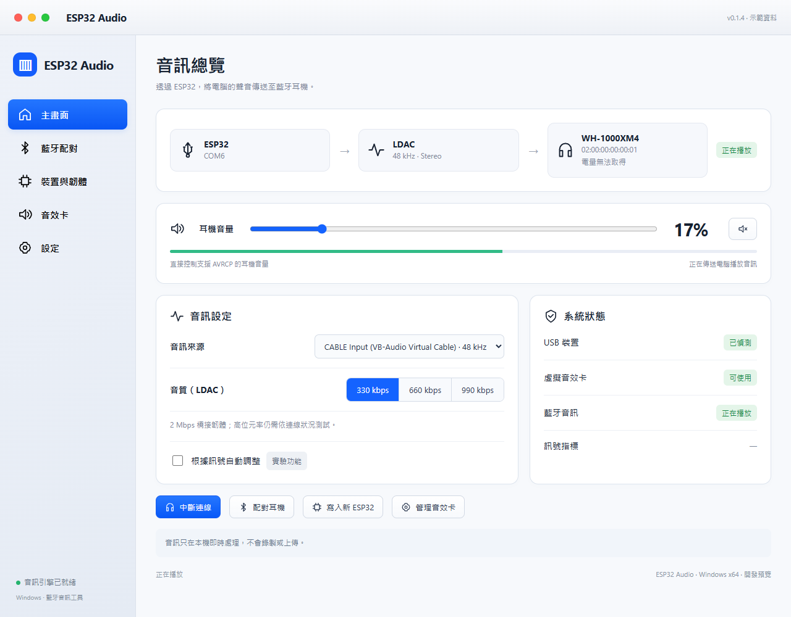
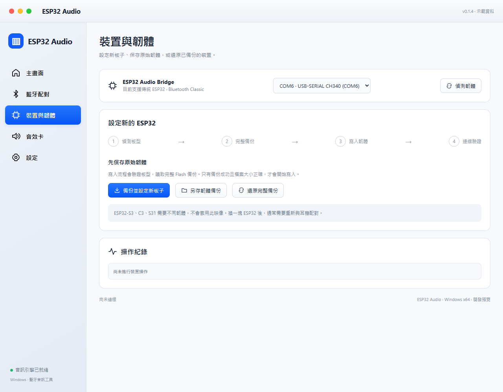
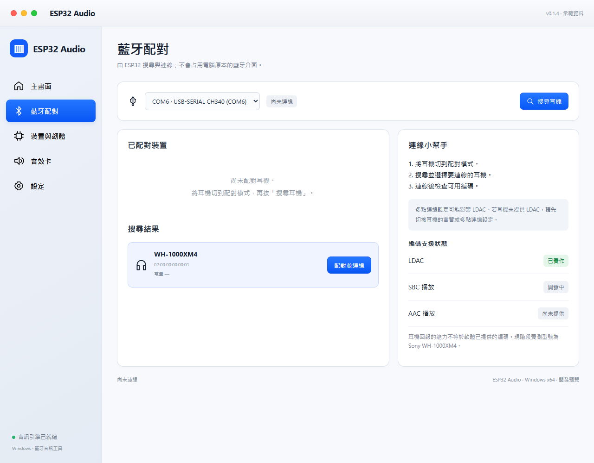
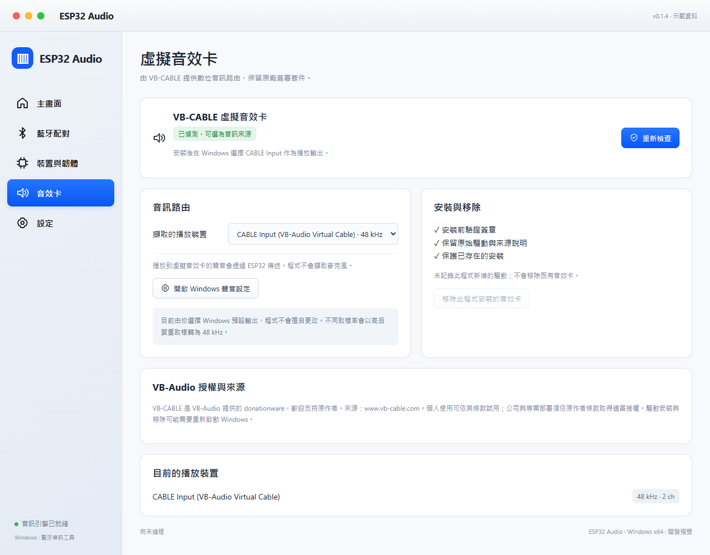
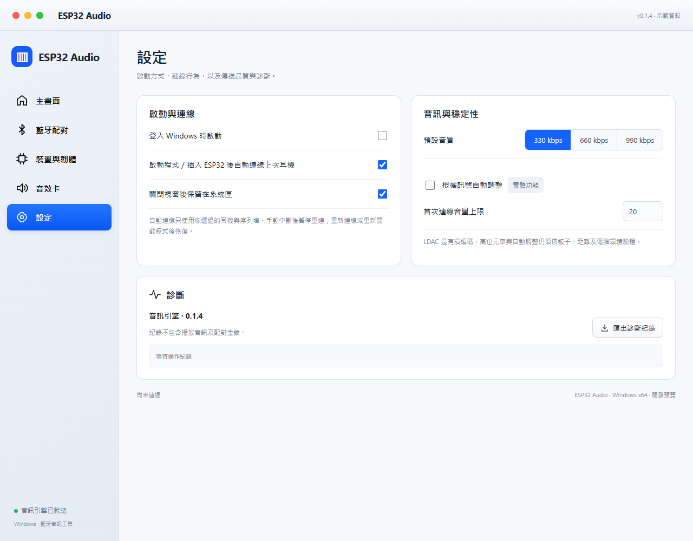
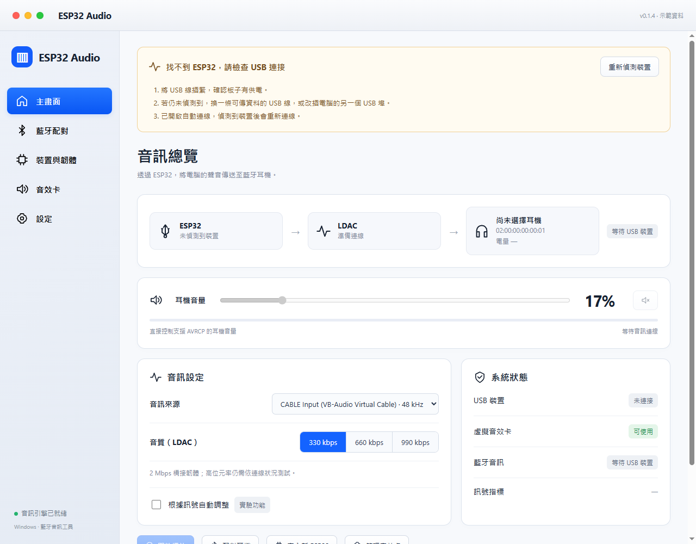

# ESP32 LDAC Audio

透過 ESP32，將 Windows 電腦的聲音傳送到支援 LDAC 的藍牙耳機。
提供 macOS 原生淺色風格的 Electron 介面、耳機配對、音量控制及新板子韌體寫入。

[下載 Windows 安裝檔](https://github.com/fgfo2018/esp32-ldac-audio/releases/tag/v0.1.4) ·
[建置說明](docs/BUILDING.md) · [故障排除](docs/TROUBLESHOOTING.md) · [更新紀錄](CHANGELOG.md)

> 截圖由 v0.1.4 的實際介面程式產生，裝置地址、連線狀態及音量使用示範資料，不含個人配對資訊。實際的序列埠、耳機名稱與可用功能依你的環境而異。

## 運作方式

Windows 音訊 → WASAPI loopback → PC 上的 LDAC 編碼器 → USB-UART HCI → ESP32 Bluetooth Classic → 耳機。

編碼在電腦進行，ESP32 提供藍牙控制器。這不是原生 USB Audio Class 音效卡；
虛擬音訊路由由 VB-CABLE 提供。LDAC 是有損編碼，990 kbps 也不代表無損。

## 功能

- 耳機搜尋、配對、連線與中斷連線，保留配對資料。
- LDAC 330／660／990 kbps，實驗性自動音質調整。
- 支援 AVRCP 的耳機音量、靜音控制。
- 約 30 Hz 即時音訊電平，隨音量變化，靜音歸零。
- 啟動程式／插入裝置後自動連線；手動中斷後暫停重連。
- 新 ESP32 板型偵測、完整 Flash 備份、橋接韌體寫入與驗證。
- 明確區分 USB 未連接、耳機未回應、序列埠占用等問題，提供修正步驟。
- 耳機電量欄位，無法讀取時明確標示，不會估算虛構百分比。
- VB-CABLE 安裝及移除管理，原本存在的驅動會保留。

## 系統與硬體

- Windows 10／11 x64；目前實測 Windows 10 19045。
- 傳統 ESP32、Bluetooth Classic、至少 4 MB Flash，例如 ESP32-D0WD-V3。
- 可傳資料的 USB 線，USB-UART 晶片須能穩定運作於 2 Mbps。
- 支援 LDAC 的耳機，目前實測 Sony WH-1000XM4。

ESP32-S2／S3／C3 等板子不能直接使用此韌體。目前只提供 LDAC 播放；
SBC／AAC 僅偵測能力，尚未提供播放；不支援僅有 LE Audio 的耳機。

## 第一次使用：從安裝到聽見聲音

### 1. 下載並安裝程式

1. 開啟 [v0.1.4 Release](https://github.com/fgfo2018/esp32-ldac-audio/releases/tag/v0.1.4)。
2. 在 **Assets** 下載 **`ESP32-Audio-Setup-0.1.4.exe`** 並執行，也可以[直接下載 EXE](https://github.com/fgfo2018/esp32-ldac-audio/releases/download/v0.1.4/ESP32-Audio-Setup-0.1.4.exe)。一般使用者不需要另外安裝 Python 或 Node.js。
3. 依安裝精靈完成安裝。詢問是否安裝 **VB-CABLE 虛擬音效卡** 時，首次使用請選擇安裝；如果已有 VB-CABLE，程式會保留原本的安裝。
4. 驅動安裝可能需要管理員允許或重新啟動 Windows，依畫面提示完成後，再開啟 **ESP32 Audio**。

`Source code`／`ESP32-Audio-Source-0.1.4.zip` 是開發用原始碼，一般使用者下載 EXE 即可。安裝檔尚未做應用程式碼簽章；VB-CABLE 使用原廠簽署套件。

### 2. 接上 ESP32，設定音訊橋接韌體

1. 用可傳資料的 USB 線把 ESP32 接到電腦，確認兩端插緊。
2. 開啟左側「**裝置與韌體**」，選擇板子的序列埠，例如 `COM6 · USB-SERIAL CH340`。每台電腦的 COM 編號可能不同，請以實際顯示為準。
3. **新板子／尚未寫入橋接韌體**：按「**備份並設定新板子**」，確認後等待偵測板型、完整備份、寫入韌體及連線驗證完成。
4. **已經設定過的板子**：按「**偵測韌體**」確認即可，不必每次重新寫入。

寫入會替換板上原本的程式；程式會先建立完整 Flash 備份，只有備份成功才寫入。操作期間請保持 USB 連接。備份與還原功能都在同一頁，備份檔請妥善保留；換一塊 ESP32 後通常需要重新與耳機配對。

**確認點：**板子能被偵測，韌體操作沒有錯誤。若沒有出現序列埠，先檢查 USB 線、插頭及 CH340／CP210x 驅動。

### 3. 讓耳機進入配對模式，再搜尋與連線

1. 依耳機本身的操作方式進入 **Bluetooth pairing／藍牙配對模式**。只開機不一定會被搜尋到。
2. 若耳機已連著手機或其他電腦，先暫時中斷那邊的連線，避免搶連。
3. 在程式左側「**藍牙配對**」選擇正確的 ESP32 序列埠，按「**搜尋耳機**」。
4. 耳機出現在搜尋結果後，按該列的「**配對並連線**」。成功後程式會切到主畫面並啟動音訊連線。
5. 之後使用同一塊 ESP32 與耳機，可以從「已配對裝置」直接連線，不必每次重新搜尋。

若耳機支援 LDAC，但連線時未提供 LDAC，請檢查耳機 App 的「音質優先」及多點連線設定；部分耳機的多點連線模式會影響 LDAC。搜尋與連線由 **ESP32** 執行，請在此程式中操作，不需要先把耳機配對到 Windows 藍牙。

**確認點：**主畫面顯示耳機名稱、LDAC 與「正在播放」。這表示音訊傳輸已啟動，還需要完成下一步的 Windows 音訊路由，才會有電腦聲音。

### 4. 設定 Windows 輸出與程式音訊來源

這一步決定電腦的聲音是否送進 ESP32 Audio。配對後若已啟動播放，**先按「中斷連線」**，完成設定後再重新連線。

1. 開啟左側「**音效卡**」，確認 VB-CABLE 顯示「已偵測，可選為音訊來源」。若安裝時跳過音效卡，請先按「**安裝音效卡**」，依提示完成安裝。
2. 按「**開啟 Windows 聲音設定**」。
3. 在 Windows 的**播放輸出裝置**選擇 **`CABLE Input (VB-Audio Virtual Cable)`**，讓電腦聲音送入虛擬音效卡。
4. 回到程式，在「擷取的播放裝置」或主畫面的「**音訊來源**」也選擇同一個 **`CABLE Input`**。
5. 回主畫面按「**開始播放**」，然後在電腦播放音樂或影片。

| 設定位置 | 應選項目 |
| --- | --- |
| Windows 聲音設定 → 播放輸出 | **CABLE Input (VB-Audio Virtual Cable)** |
| ESP32 Audio → 音訊來源 | 相同的 **CABLE Input**，名稱後可能顯示 `48 kHz`。 |
| ESP32 Audio → 藍牙耳機 | 剛才已配對、支援 LDAC 的耳機。 |

`CABLE Input` 是這個流程使用的 Windows **播放端**；`CABLE Output` 是錄音端，請確認選對名稱。程式不會自動更改 Windows 預設輸出。如果只想傳送某個應用程式的聲音，也可在 Windows 的個別應用程式音訊設定中，將該程式輸出指定為 CABLE Input。

**確認點：**電腦播放音樂時，主畫面的綠色音訊電平會變動，耳機有聲音。若綠條不動，先檢查 Windows 輸出與程式來源；若綠條會動但耳機無聲，再檢查耳機連線、音量與靜音。

### 5. 調整音量與音質

對照上方主畫面，控制項用途如下：

| 控制 | 用途與建議 |
| --- | --- |
| 藍色「耳機音量」滑桿 | 調整耳機音量，支援時會使用 AVRCP 硬體音量；首次播放先從小音量開始。 |
| 喇叭／靜音按鈕 | 切換靜音與恢復音量。 |
| 下方綠色橫條 | 約 30 Hz 更新的**即時音訊電平**，顯示目前擷取聲音的強弱，並非音量設定或電量。 |
| 330／660／990 kbps | 先從 **330 kbps** 確認穩定，再嘗試 660／990；990 需要內附的 2 Mbps 橋接韌體。 |
| 根據訊號自動調整 | 實驗功能，依連線狀況調整音質；實際效果依硬體與環境而異。 |
| 中斷連線 | 停止目前連線，保留耳機配對資料。 |

音訊來源在**下次連線時**套用；播放中修改來源後，請中斷再連線。也可選擇「系統預設播放裝置」擷取一般輸出，但原本的喇叭可能同時播放。

### 6. 開啟自動連線，方便之後使用

在左側「**設定**」依需求勾選：

- **啟動程式／插入 ESP32 後自動連線上次耳機**：保留上次耳機與序列埠，之後可自動連線。
- **登入 Windows 時啟動**：登入時開啟程式。
- **關閉視窗後保留在系統匣**：關閉視窗後繼續執行；要完全離開，從系統匣選單選「結束」。

之後通常只需要：**接上 ESP32 → 開啟耳機 → 開啟程式／等待自動連線 → 播放音樂**。
手動按「中斷連線」會暫停自動重連；重新按連線、關閉再開啟自動連線設定，或重開程式即可恢復。不再透過本程式聽音樂時，記得把 Windows 輸出切回原本的喇叭或其他音效裝置。

## 遇到問題時先看這裡

程式會在各頁頂端持續顯示錯誤提示，附上修正步驟與「重新偵測裝置」或「重試連線」等操作，原始錯誤碼可展開查看。

| 情況 | 優先檢查 |
| --- | --- |
| 找不到 ESP32／沒有 COM 埠 | USB 兩端是否插緊、線是否能傳資料、CH340／CP210x 驅動是否已安裝。 |
| 搜尋不到耳機 | 耳機是否真的進入配對模式；已配對者可直接從清單連線。 |
| 耳機未回應／PAGE_TIMEOUT | 耳機是否開機、靠近 ESP32，並暫時中斷手機或其他電腦連線。 |
| 序列埠無法開啟 | 關閉 Arduino 序列監控或其他占用該 COM 埠的程式。 |
| 已連線但沒有聲音 | Windows 輸出與程式來源都選 CABLE Input，並檢查音量／靜音。 |
| 音訊斷續 | 先降至 330 kbps、靠近 ESP32、減少干擾，確認使用正確的 2 Mbps 韌體。 |
| 電量無法取得 | 耳機未提供目前可讀取的回報，不代表電量為零。 |

查看 USB 連接錯誤提示範例

更多說明請見 [故障排除](docs/TROUBLESHOOTING.md)。持續失敗可在「設定」按「匯出診斷紀錄」；公開分享前請移除不想公開的裝置地址等資訊。

330／660／990 kbps 已通過短時間測試，尚未保證所有耳機或長時間使用皆穩定。實際表現受距離、干擾、USB 晶片及電腦排程影響。

## 已知限制

WH-1000XM4 在目前實測環境仍未回報電量，會顯示「電量無法取得」。
電量讀取提供 Fast Pair／Sony MDR v1 實作，依裝置實際支援情況而定。
手動中斷後，重新按連線、切換自動連線設定或重開程式可恢復自動連線。

## 資料與移除

不擷取麥克風、不錄製或上傳播放音訊。設定、耳機配對金鑰、韌體備份與紀錄
保存在本機使用者資料夾，不放進倉庫或安裝檔。更換 ESP32 通常需重新配對。

從 Windows 已安裝應用程式移除 ESP32 Audio。只有本程式新安裝且識別相符的
VB-CABLE 才會詢問是否移除；既有驅動及靜默移除時的驅動會保留。
其他應用程式若仍使用 VB-CABLE，請保留它。

## 開發與授權

[從原始碼建置](docs/BUILDING.md)。包含 Electron UI、Python 引擎、ESP32 韌體、
Sony 編碼器來源、測試及打包設定。

[授權說明](LICENSING.md)。VB-CABLE 來自 [VB-Audio](https://www.vb-cable.com/)，
屬 donationware，歡迎支持原作者；公司／專業部署請依原作者條款取得授權。
其他元件保留各自授權。本專案與 Sony、Espressif、Google、VB-Audio 無關聯。
